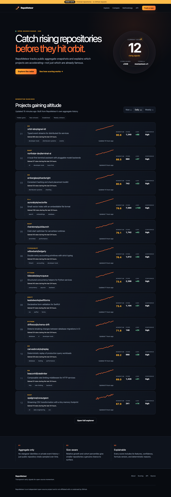
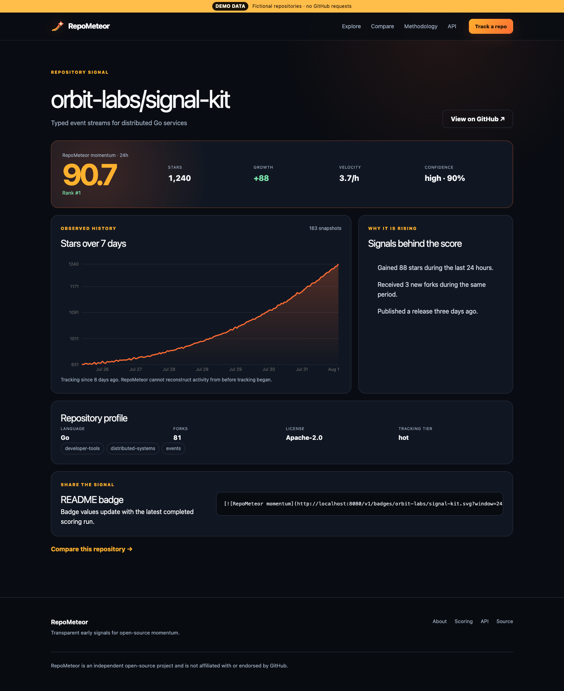
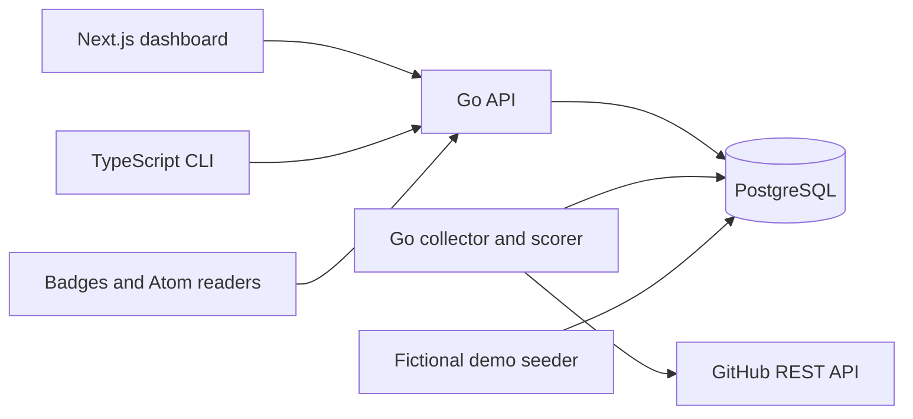

<p align="center">
  
</p>

# RepoMeteor

**Catch rising repositories before they hit orbit.**


RepoMeteor is an open-source GitHub momentum engine. It stores periodic
aggregate repository snapshots and ranks projects using star velocity,
relative growth, acceleration, forks, freshness, and activity.

It does not track individual stargazers and does not claim to reproduce
GitHub Trending.

The dashboard, public API, CLI, Atom feed, and SVG badges all expose the same deterministic scores and plain-language reasons. Demo mode ships with visibly labeled fictional data, so the complete product can run without a token or outbound GitHub traffic.





<sub>Captured from the deterministic demo dataset with `pnpm capture:screenshots`. Every repository shown is fictional.</sub>

## Why RepoMeteor exists

Large lifetime star totals hide early movement. RepoMeteor keeps its own scheduled aggregate history, normalizes projects against the same observed cohort, gives relative growth meaningful weight, and publishes both confidence and explanations. Smaller projects can surface without an opaque model or individual-user tracking.

## Highlights

- 6-hour, 24-hour, and 7-day rankings with Rising, Hidden Gems, New Entrants, and Established collections.
- Language, topic, star-range, and confidence filters with cursor pagination.
- Repository history, comparison, search, public tracking submission, badges, and Atom feeds.
- Pure, versioned `momentum-v1` scoring with stored raw features and reasons.
- Go API and worker, PostgreSQL-only persistence, TypeScript CLI, and server-rendered Next.js UI.
- Deterministic offline demo mode and Docker Compose local development.

## Quick demo

Prerequisites: Docker 29+ with Compose 5+.

```bash
cp .env.example .env
docker compose up --build
```

Open <http://localhost:3000>. The API is at <http://localhost:8080>; `curl http://localhost:8080/healthz` should return `status: ok`. Demo data is fictional and permanently labeled.

## Live mode

Create `.env` from the example and set:

```dotenv
DEMO_MODE=false
NEXT_PUBLIC_DEMO_MODE=false
GITHUB_TOKEN=github_pat_replace_me
```

Use a read-only token for public repositories. Review `GITHUB_RATE_BUDGET_PERCENT`, public URLs, CORS, trusted proxies, backups, and rate-limit key before deployment. RepoMeteor uses GitHub REST search and aggregate repository endpoints; it never scrapes Trending HTML or lists stargazers.

## CLI

```bash
pnpm install --frozen-lockfile
pnpm --filter @repometeor/cli build
pnpm --filter @repometeor/cli exec repometeor trending --window 24h
pnpm --filter @repometeor/cli exec repometeor inspect orbit-labs/signal-kit
pnpm --filter @repometeor/cli exec repometeor compare owner/a owner/b --json
```

Set `REPOMETEOR_API_URL` or pass `--api-url`. Commands are `trending`, `inspect`, `track`, `compare`, and `config`; global options include `--json`, `--no-color`, and `--timeout`.

## Architecture



See [Architecture](docs/ARCHITECTURE.md) and [decisions](docs/DECISIONS.md).

## Scoring overview

For each window, RepoMeteor calculates star velocity, relative growth, acceleration, fork velocity, recent activity, and freshness. Skewed features are transformed and winsorized, then converted to deterministic cohort percentiles. The weighted raw score is adjusted by observed-history confidence and clamped to 0–100. Exact weights, eligibility, collections, and versioning rules are in [SCORING.md](docs/SCORING.md).

## API examples

```bash
curl 'http://localhost:8080/v1/trending?window=24h&collection=hidden-gems&language=Go'
curl 'http://localhost:8080/v1/repositories/orbit-labs/signal-kit/history?range=7d'
curl 'http://localhost:8080/v1/compare?repositories=owner/a,owner/b&window=24h'
```

The OpenAPI 3.1 source is [contracts/openapi.yaml](contracts/openapi.yaml). Errors use `application/problem+json` and include a request ID.

## Badge

```md
[](http://localhost:3000/r/orbit-labs/signal-kit)
```

Badge options are `window=6h|24h|7d`, `metric=momentum|stars|delta`, and `theme=auto|light|dark`.

## Atom feed

```text
http://localhost:8080/v1/feeds/trending.xml?window=24h&collection=hidden-gems
```

The feed accepts the same bounded filters as trending and labels demo content.

## Privacy

RepoMeteor stores aggregate public repository data, not individual stargazer identities. Public tracking limits store HMAC-derived counters rather than raw addresses. Read [PRIVACY.md](docs/PRIVACY.md) for operator responsibilities.

## Self-hosting

Start with [SELF_HOSTING.md](docs/SELF_HOSTING.md), use [DEPLOYMENT.md](docs/DEPLOYMENT.md) for production/Railway guidance, and keep [RUNBOOK.md](docs/RUNBOOK.md) with the on-call process.

## Development

```bash
make bootstrap
make format
make lint
make typecheck
make test
make test-integration
make build
make smoke
```

See [CONTRIBUTING.md](CONTRIBUTING.md) and [AGENTS.md](AGENTS.md) for prerequisites, boundaries, migrations, and the full definition of done.

## Roadmap

The v0.1 vertical slice is followed by retention tooling, export formats, shell completion, and broader deployment examples. See [ROADMAP.md](ROADMAP.md); proposals belong in issues before large implementation changes.

## Contributing

Contributions are welcome. Start with [GOOD_FIRST_ISSUES.md](docs/GOOD_FIRST_ISSUES.md), run the relevant gates, and include contract/docs updates with behavior changes. Participation is governed by [CODE_OF_CONDUCT.md](CODE_OF_CONDUCT.md).

## Security

Do not report secrets or exploitable details in a public issue. Report privately through the repository's **Security** tab using **Report a vulnerability**. Follow [SECURITY.md](SECURITY.md), including the token-exposure procedure.

## License

Apache License 2.0. See [LICENSE](LICENSE) and [NOTICE](NOTICE).

RepoMeteor is an independent open-source project and is not affiliated with or endorsed by GitHub.
