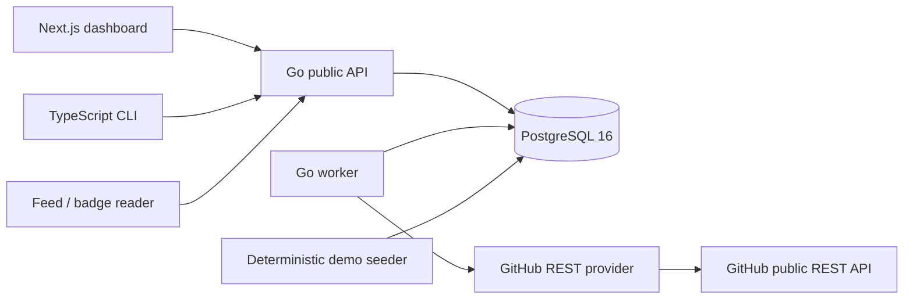

# Architecture

RepoMeteor is a small monolith split into deployable processes. PostgreSQL is its only required stateful service.

## Request path

Gin applies request IDs, structured request logging, recovery, security headers, exact-origin CORS, body limits, and read throttling before handlers. Handlers validate bounded inputs and map service results to versioned DTOs. The service layer coordinates repositories, snapshots, scores, jobs, aliases, and rate limits. Repository packages issue parameterized SQL through bounded `pgxpool` connections.

Health is split correctly: `/healthz` proves process liveness without touching dependencies, while `/readyz` checks PostgreSQL. `/metrics` exposes a private-by-deployment Prometheus surface; do not put it behind the public CDN without access controls.

## Collection and scoring path

The scheduler enqueues discovery, scoring, and tier-refresh jobs. A dispatcher turns due repositories into collection jobs. Workers claim durable rows with `FOR UPDATE SKIP LOCKED`; active dedupe keys prevent concurrent duplicates. Collection uses conditional validators, a shared rate-budget manager, bounded retries, aggregate-only fields, and idempotent UTC snapshot buckets.

Scoring loads bounded histories, computes pure features for all three windows, normalizes the fully eligible cohort, assigns deterministic ranks and collections, and persists a complete run. API reads never calculate scores inline.

## Demo and live modes

Demo mode seeds at least 50 fictional repositories with fixed history, uses an in-memory fixture provider, and disables live dispatch. Live mode requires a GitHub token, discovers repositories through partitioned REST Search queries, and polls hot/warm/cold tiers on configured cadences.

## Data retention and growth

Snapshot and score tables are append-oriented except for idempotent bucket updates. Operational pruning methods exist for old completed jobs, request validators, counters, and score runs; deployments should schedule and monitor retention according to their traffic and backup policy. Repository history is preserved across renames and missing states.

## Performance

The initial web route is server rendered. Client JavaScript is limited to interactive filters/forms and charts. API list sizes and history ranges are bounded, expensive responses have short public cache headers and ETags, database indexes match ranking and history queries, GitHub response bodies and retries are capped, worker batches are bounded, and database pools have explicit limits. Repository names never appear as Prometheus labels.

Horizontal API scaling is safe when instances share PostgreSQL and `RATE_LIMIT_KEY`. Worker scaling relies on job claims, but discovery/scoring cadence should still be monitored to avoid redundant scheduled work. No component requires sticky sessions.
